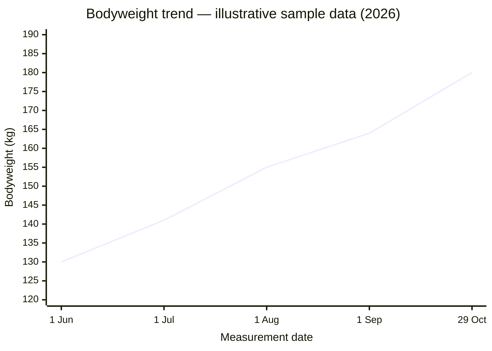

# Gym Data

[Back](README.md)

This is up to date GYM date for my friend Tom Fardell.

## Personal records (PRs)

Provisional sample entries to adjust and confirm. Equipment and dates are illustrative, not verified training history. Loads are total external weight, including any bar or handles, rather than weight per hand. Each entry records one repetition; these are not verified one-repetition maximums.

| Exercise | PR load (kg total) | Repetitions | Equipment | Date | Status |
| -------- | -----------------: | ----------- | --------- | ---- | ------ |
| Bench press | 5 | 1 | Two 2.5 kg dumbbells, flat bench | 12/10/26 | Provisional |
| Deadlift | 10 | 1 | 10 kg kettlebell | 19/10/26 | Provisional |
| Squat | 5 | 1 | 5 kg dumbbell, goblet hold | 24/10/26 | Provisional |

### Bodyweight trend

Illustrative sample data, not recorded measurements. Intermediate values are invented to show the requested June–October trend.

| Date | Bodyweight (kg) | Change (kg) |
| ---- | --------------: | ----------: |
| 01/06/26 | 130 | — |
| 01/07/26 | 141 | +11 |
| 01/08/26 | 155 | +14 |
| 01/09/26 | 164 | +9 |
| 29/10/26 | 180 | +16 |

## Exercise catalogue

Suggested light starting loads to try and adjust, not recorded lifts or targets based on body size. Choose a load that allows controlled repetitions with a few repetitions still possible at the end. Reduce it or use the easier variation if technique becomes difficult.

All weights are in kilograms. Dumbbell loads are **per hand** unless stated otherwise; cable and machine loads are the displayed stack setting. Machine resistance varies: use the lightest setting first, even if it differs from the examples below. Bodyweight means no added weight.

This is a menu of alternatives, not one workout. Start with a small selection covering legs, pushing, pulling and core; try one set per exercise before adding more. Repetitions for unilateral exercises are per side.

### Legs and hips

| Exercise | Suggested starting load | Repetitions | Notes / easier option |
| -------- | ---------------------- | ----------- | --------------------- |
| Chair sit-to-stand | Bodyweight | 5–10 | Use a stable chair; use hands for assistance if needed |
| Supported squat | Bodyweight | 5–10 | Hold a stable support and use a comfortable depth |
| Goblet squat | 2–4 kg total | 8–12 | Hold one dumbbell at chest height; start with supported squats |
| Leg press | Lightest machine setting | 8–12 | Sled weight varies; ask staff to check setup |
| Low step-up | Bodyweight | 5–10 | Use a low step and stable handhold |
| Supported split squat | Bodyweight | 5–10 | Hold a support; shorten the range initially |
| Reverse lunge | Bodyweight | 5–10 | Use support or substitute a split squat |
| Dumbbell Romanian deadlift | 2–4 kg | 8–12 | Practise the hip hinge without weights first |
| Glute bridge | Bodyweight | 8–12 | Start on the floor with both feet planted |
| Hip thrust | Bodyweight | 8–12 | Substitute floor bridges while learning |
| Seated leg curl | 2.5–5 kg or lightest setting | 8–12 | Adjust the seat and pad before starting |
| Leg extension | 2.5–5 kg or lightest setting | 8–12 | Use a comfortable range and controlled movement |
| Standing hip abduction | Bodyweight | 8–12 | Hold a support; lift the leg sideways without leaning |
| Standing hip extension | Bodyweight | 8–12 | Hold a support; avoid arching the back |
| Hip abduction machine | Lightest setting | 8–12 | Keep the torso steady |
| Hip adduction machine | Lightest setting | 8–12 | Use a comfortable range |
| Standing calf raise | Bodyweight | 8–12 | Use both legs and hold a support |

### Chest, shoulders and triceps

| Exercise | Suggested starting load | Repetitions | Notes / easier option |
| -------- | ---------------------- | ----------- | --------------------- |
| Wall press-up | Bodyweight | 5–10 | Stand nearer the wall to make it easier |
| Incline press-up | Bodyweight | 5–10 | Use a stable high surface; substitute wall press-ups |
| Dumbbell floor press | 1–3 kg | 8–12 | Start on the floor to limit depth |
| Dumbbell bench press | 1–3 kg | 8–12 | Use a flat bench; ask for a technique check |
| Incline dumbbell press | 1–3 kg | 8–12 | Use a shallow bench incline |
| Chest press machine | 2.5–5 kg or lightest setting | 8–12 | Adjust handles to chest height |
| Seated dumbbell shoulder press | 1–2 kg | 8–12 | Use a comfortable overhead range |
| Dumbbell lateral raise | 0.5–1 kg | 8–12 | Lift without swinging or shrugging |
| Dumbbell reverse fly | 0.5–1 kg | 8–12 | Support the chest on an incline bench |
| Cable triceps pushdown | 1.25–2.5 kg or lightest setting | 8–12 | Keep upper arms still |
| Two-hand overhead triceps extension | 1–2 kg total | 8–12 | One dumbbell held with both hands |

### Back, biceps and grip

| Exercise | Suggested starting load | Repetitions | Notes / easier option |
| -------- | ---------------------- | ----------- | --------------------- |
| Seated cable row | 2.5–5 kg or lightest setting | 8–12 | Keep the torso steady |
| Chest-supported dumbbell row | 1–3 kg | 8–12 | Rest the chest on an incline bench |
| Supported one-arm dumbbell row | 2–4 kg | 8–12 | Support the free hand on a stable bench |
| Lat pulldown | 2.5–5 kg or lightest setting | 8–12 | Pull in front of the body; avoid leaning back |
| Band row | Light resistance band | 8–12 | Use a secure anchor and inspect the band |
| Band pull-apart | Light resistance band | 8–12 | Use a relaxed grip and comfortable range |
| Cable face pull | 1.25–2.5 kg or lightest setting | 8–12 | Pull towards face level without shrugging |
| Dumbbell biceps curl | 1–2 kg | 8–12 | Keep elbows near the torso |
| Dumbbell hammer curl | 1–2 kg | 8–12 | Keep palms facing inward |
| Farmer carry | 2–4 kg | 15–30 seconds | Walk slowly with an upright posture |
| Suitcase carry | 2–4 kg in one hand | 15–30 seconds per side | Stay upright without leaning |

### Core

| Exercise | Suggested starting load | Repetitions / duration | Notes / easier option |
| -------- | ---------------------- | ---------------------- | --------------------- |
| Supine heel slide | Bodyweight | 5–10 per side | Slide one heel away while keeping the trunk steady |
| Dead bug | Bodyweight | 5–10 per side | Start with arms still and move one leg at a time |
| Bird dog | Bodyweight | 5–10 per side | Start by moving only one arm or leg |
| Knee plank | Bodyweight | 10–20 seconds | Use a wall plank if needed |
| Side plank from knees | Bodyweight | 10–15 seconds per side | Keep knees bent and hips aligned |
| Pallof press | Light band or lightest cable setting | 8–12 per side | Resist twisting; use a secure anchor |

## Adjusting the loads

Record the load actually used rather than treating these suggestions as achievements. Increase repetitions gradually, then try the smallest available weight increase when the movement feels controlled and comfortable. If the next machine setting is too heavy, choose a lighter dumbbell, band or bodyweight alternative. Stop an exercise if it causes pain.

The [NHS strength exercise guide](https://www.nhs.uk/live-well/exercise/strength-exercises/) includes gentle bodyweight options and recommends building up gradually. The numerical loads above are editable examples, not NHS weight prescriptions.

## Training log

| Date | Exercise | Load (kg; specify per hand or total) | Sets | Repetitions / duration | Notes |
| ---- | -------- | ----------------------------------- | ---- | ---------------------- | ----- |
| | | | | | |
